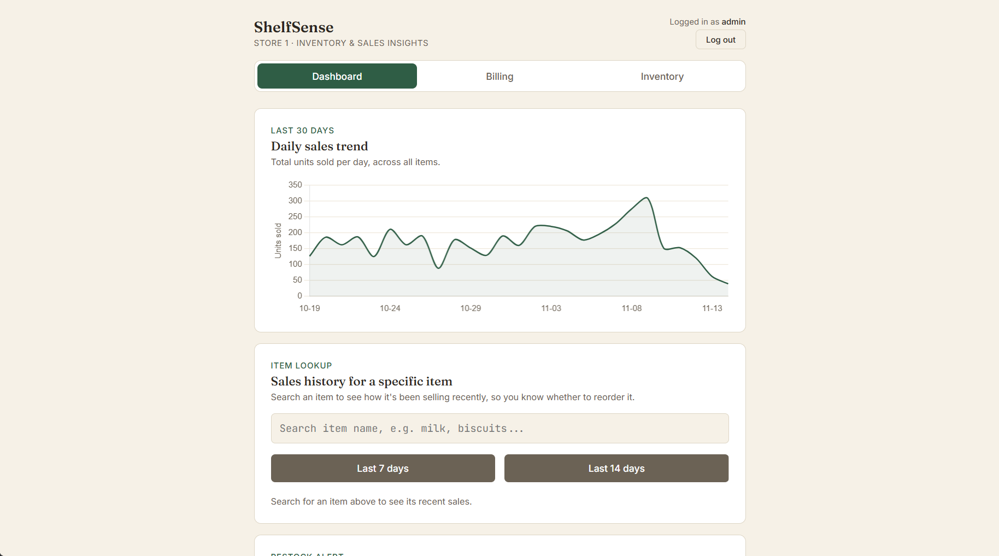
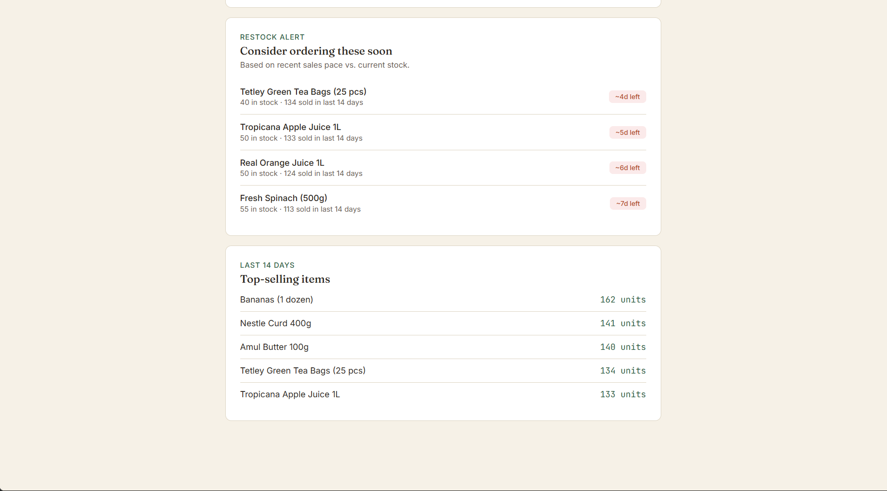
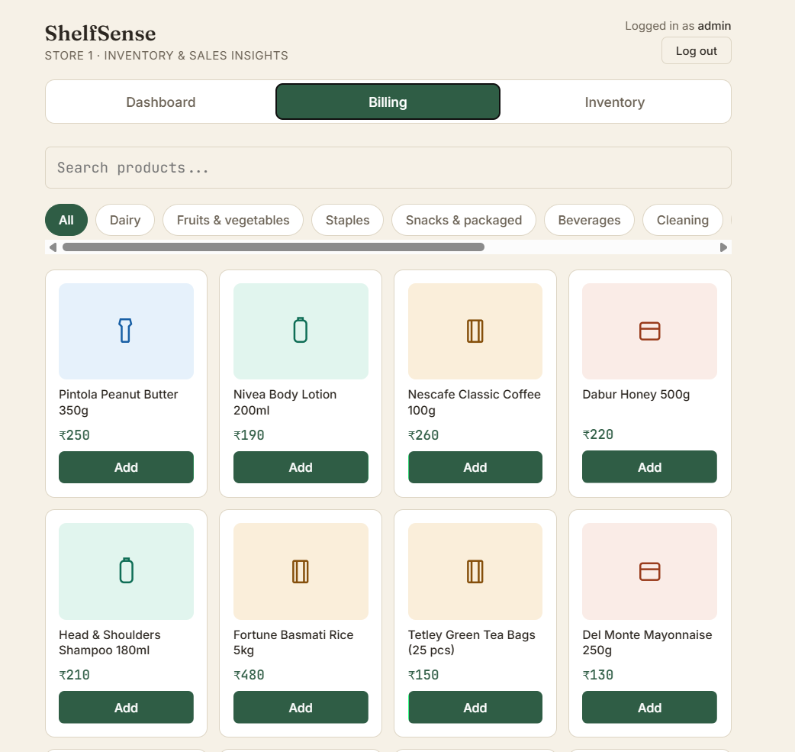
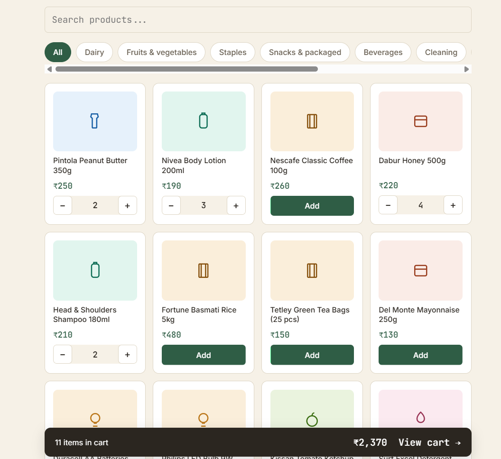
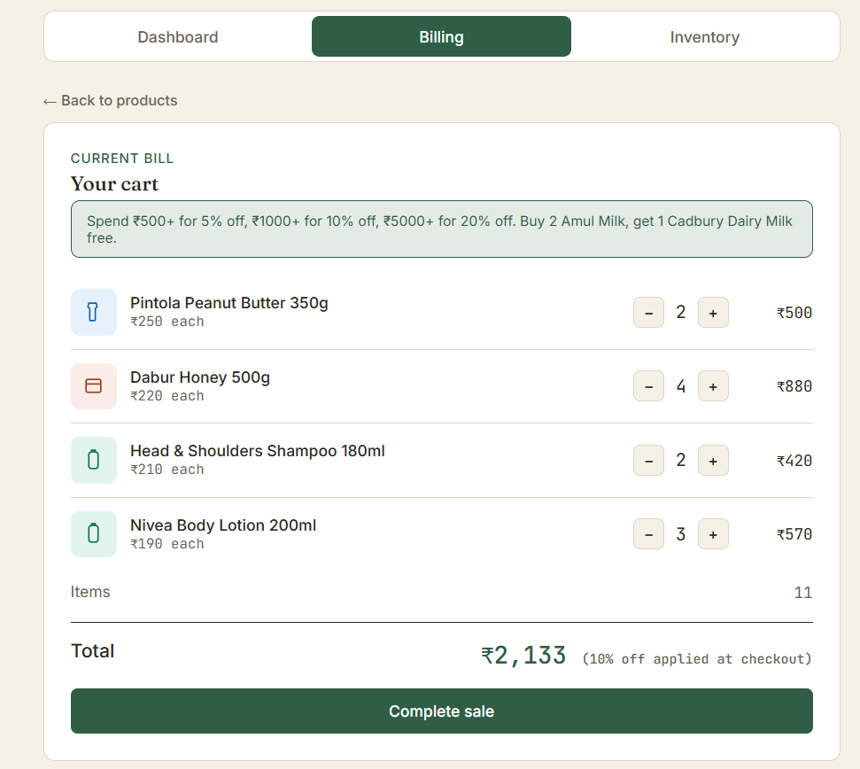
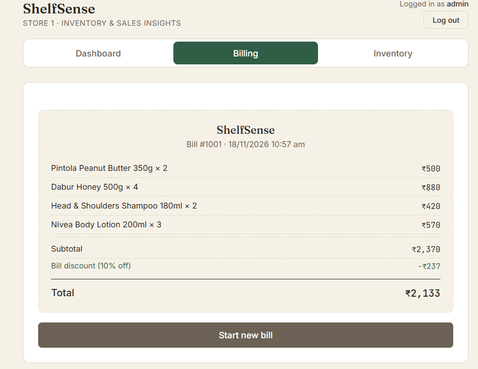
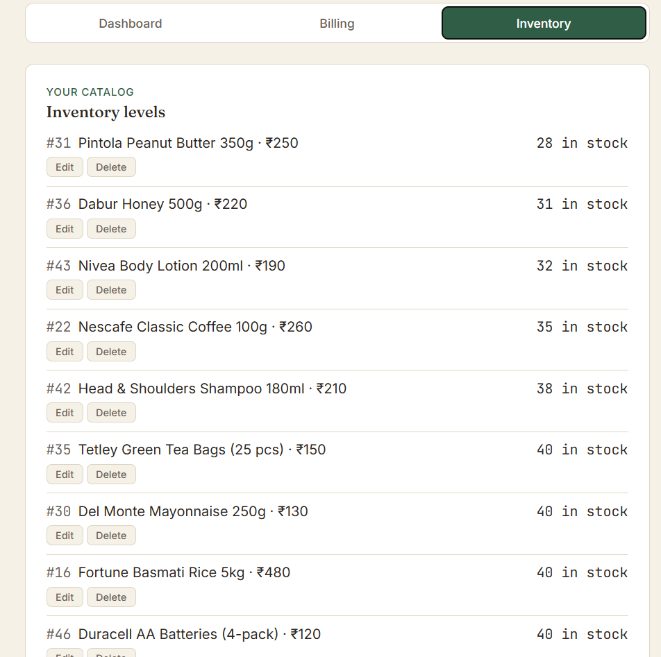
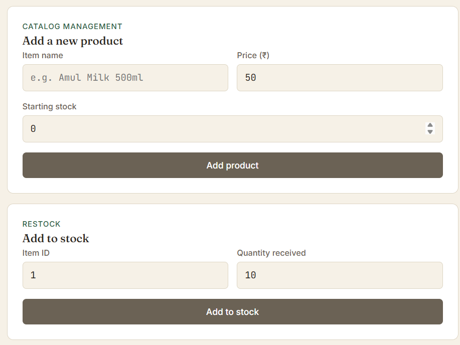
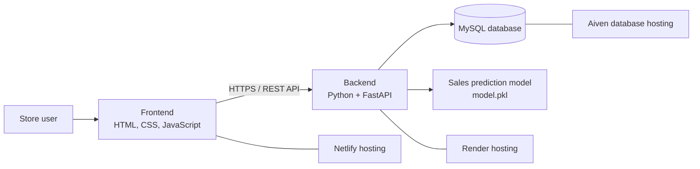

<div align="center">

# ShelfSense

### Retail Inventory, Billing & Sales Insights

A retail management application for general stores and retail businesses, bringing product management, point-of-sale billing, inventory tracking and sales insights into one place.

[Live Application](https://store-management-ai.netlify.app) · [Backend API Documentation](https://store-management-app-86sz.onrender.com/docs) · [GitHub Repository](https://github.com/Anshuman-Singh-8578/Store-Management-App)

</div>

---

## Overview

ShelfSense is designed to help general stores and retail businesses manage everyday store operations from a single application. It combines a product catalogue and billing workflow with inventory updates, sales reporting and restocking insights.

The application is deployed as a hosted web app. **Access to the application requires login credentials.** Contact the project owner if you need demo access.

> **Deployment note:** The frontend is hosted on Netlify and the FastAPI backend is hosted on Render. The backend may take approximately 30–60 seconds to wake up when it has been idle on the free hosting tier.

## Screenshots

### Dashboard & sales insights

The dashboard presents sales trends, item-level sales history, restocking alerts and top-selling products.

<p align="center">
  
</p>

<p align="center">
  
</p>

### Point of sale & billing

Browse products, filter the catalogue, add items to the cart, adjust quantities and complete a sale. The checkout view displays applicable discounts and the final bill.

<p align="center">
  
</p>

<p align="center">
  
</p>

<p align="center">
  
</p>

<p align="center">
  
</p>

### Inventory & catalogue management

View current stock levels, edit or remove catalogue items, add new products and record incoming stock.

<p align="center">
  
</p>

<p align="center">
  
</p>

## Features

- **Product catalogue:** Browse products by category and search the catalogue.
- **Point-of-sale billing:** Add products to a cart, change quantities and complete sales.
- **Itemized receipts:** Generate a receipt showing purchased items, subtotal, discount and final amount.
- **Inventory management:** Add, edit and delete products, and record received stock.
- **Automatic stock deduction:** Update inventory when a sale is completed.
- **Sales analytics:** Review top-selling products and visualize daily sales trends.
- **Item-level sales history:** Inspect recent sales for a selected product over supported date ranges.
- **Restock alerts:** Highlight products that may need replenishment based on recent sales pace and available stock.
- **Sales prediction:** The backend uses the serialized `model.pkl` machine-learning model for sales prediction.
- **Discount engine:** Supports bill-value discounts, Buy X Get Y Free offers and configured seasonal category discounts.

## Technology stack

| Layer | Technologies |
|---|---|
| Frontend | HTML, CSS, JavaScript |
| Backend | Python, FastAPI |
| Database | MySQL |
| ORM / database access | SQLAlchemy |
| Data processing and machine learning | pandas, scikit-learn, serialized `model.pkl` |
| Charts | Chart.js |
| Frontend hosting | Netlify |
| Backend hosting | Render |
| Database hosting | Aiven |

## Architecture



The frontend communicates with the FastAPI backend through API requests. The backend handles application logic, database operations, billing and analytics. MySQL stores the application data, while the backend loads the serialized model for sales prediction.

## Important implementation details

### Billing and inventory consistency

The original project documentation describes billing operations that write transaction records and update inventory within a database transaction. This is intended to ensure that a multi-item sale is handled as one unit: if the operation fails, partial database changes are rolled back.

### Discount handling

The checkout workflow supports the following discount types, as configured by the application:

- Tiered discounts based on bill value.
- Buy X Get Y Free promotions.
- Seasonal discounts for configured product categories and date ranges.

### Restocking insights

Restock alerts consider recent sales pace alongside current stock. The dashboard presents an estimate of how many days of stock may remain, helping a store operator identify products that may need attention.

### Sales prediction

The repository includes a serialized machine-learning artifact named `model.pkl`. The backend uses this model for sales prediction. The exact model algorithm, training dataset, evaluation metrics and prediction horizon should be documented here once those implementation details are confirmed.

## Live application & API

| Resource | Link |
|---|---|
| ShelfSense web application | https://store-management-ai.netlify.app |
| FastAPI interactive API documentation | https://store-management-app-86sz.onrender.com/docs |
| Source code | https://github.com/Anshuman-Singh-8578/Store-Management-App |

**Login required:** The deployed application requires login credentials. Demo credentials are not published in this README. Contact the project owner to request access.

**Hosting note:** The backend is deployed on Render. On an idle free-tier instance, the first request may take around 30–60 seconds while the service starts.

## Database & deployment notes

ShelfSense uses MySQL for persistent application data. The current hosted deployment uses an Aiven-hosted MySQL database.

A separate MySQL database can be configured for a separate deployment. However, **running the complete application locally is not currently supported by this project**, so this README does not provide local startup commands.

Database credentials and other secrets should be supplied through environment configuration in the deployment environment. Do not commit passwords, API keys or database connection strings to the repository.

## Project structure

```text
Store-Management-App/
├── frontend/           # Web application files
├── backend.py          # FastAPI backend
├── model.pkl           # Serialized sales prediction model
├── requirements.txt    # Python dependencies
├── setup_demo.py       # Demo/setup utility
├── .gitignore
└── README.md
```

## Development

ShelfSense was developed independently, with AI coding assistance used as part of the development process. The project brought together frontend development, backend API development, relational database operations, billing workflows and machine-learning integration.

## Possible future improvements

- Multi-store support.
- More granular user roles and permissions.
- Exportable sales reports (CSV/PDF).
- Expanded model documentation, evaluation metrics and prediction visualizations.
- Automated tests for billing, inventory and prediction workflows.

## Contact

For questions about the project or to request access to the hosted application, reach out through the repository owner's GitHub profile:

[Anshuman-Singh-8578](https://github.com/Anshuman-Singh-8578)

---

<div align="center">

**ShelfSense** · Built for smarter day-to-day retail management.

</div>
